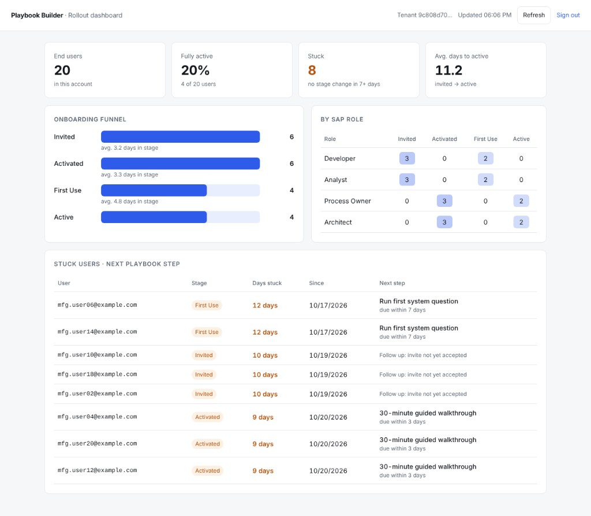
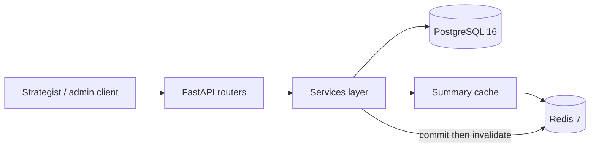

# Conduct Playbook Builder

*Conduct makes SAP knowledge available at scale. This tool tries to do the same for deployment knowledge.*

**[Live demo →](https://conduct-playbook-api.onrender.com/dashboard)** Click **View demo data** for an instant look. The free host sleeps when idle, so the first load can take up to a minute.

[Conduct](https://conduct.ai) is an AI operating system for enterprise software, starting with SAP. This repository is **not** that product. It is a multi-tenant **deployment onboarding tracker** so Conduct’s deployment strategists can land and stick the product at enterprise accounts after a sale.

## Why this exists

**Assumption (not a company claim):** after each sale, a small GTM / deployment-strategist team must onboard hundreds of end users per customer. Today that work does not scale well—invites, stage tracking, and “what good looks like” live in people’s heads, so capacity grows mainly by hiring.

This tool captures that deployment knowledge as reusable **playbooks** and gives strategists (and customer admins) a clear view of who is stuck and how a rollout is progressing—without matching headcount to every new account.

## Features

- **Tenants & invites** — create a customer account, invite end users, accept invites (argon2 passwords), advance stages one step at a time (`invited → activated → first_use → active`)
- **Playbooks** — global default template copied per tenant; next steps for a user’s current stage
- **Rollout summary** — users per stage, SAP role × stage counts, stuck count, average days per stage (SQL aggregates)
- **Stuck users** — paginated list with days stuck and the next playbook step
- **Redis cache** for summaries (`summary:v1:{tenant_id}`), invalidated **after** DB commit; Postgres fallback if Redis is down
- **Security** — HS256 JWTs, tenant scoping, invite token hashing, no personal data in logs
- **Seed data** — fictional demo tenants via `make seed` (idempotent)
- **Rollout dashboard** — browser UI at [`/dashboard`](http://localhost:8000/dashboard) (summary, funnel, stuck users)



## Architecture



Layers: **routers** = HTTP only; **services** = business rules; **models** = persistence. State changes that affect rollout metrics commit to Postgres first, then delete the Redis summary key so concurrent readers cannot repopulate a stale cache.

## Security model

| Concern | Behaviour |
| --- | --- |
| Roles | `strategist` (platform), `customer_admin` (one tenant), `end_user` (no management APIs) |
| Tenant isolation | Every tenant-scoped query goes through `accessible_tenant_ids`; inaccessible tenants return **404**, not 403 (no tenant-id enumeration) |
| Invites | `secrets.token_urlsafe(32)`; store **SHA-256 hash only**; expiry + single use; one generic error for invalid/expired/used |
| Passwords | argon2 hashes in `users.password_hash` |
| Auth | Short-lived HS256 JWTs (`sub`, `role`, `tenant_id`, `exp`); algorithm allow-list |
| Logs | IDs only—never emails, names, passwords, tokens, or JWTs |

Design write-ups: [`docs/decisions.md`](docs/decisions.md). Phase history: [`docs/phase-log.md`](docs/phase-log.md).

## Live demo on Render (free)

A Blueprint in [`render.yaml`](render.yaml) provisions a free web service, Postgres 16, and Redis-compatible Key Value.

1. Push `main` (this repo already includes the Blueprint).
2. In the [Render Dashboard](https://dashboard.render.com): **New → Blueprint**.
3. Connect `mohamedalsayed12/conduct-playbook-builder`, branch `main`, then **Deploy Blueprint**.
4. Wait for the first build. On start the container runs `alembic upgrade head` and the idempotent seed (free plans do not support a pre-deploy command).

**Live demo:** [conduct-playbook-api.onrender.com](https://conduct-playbook-api.onrender.com) (opens the dashboard; click **View demo data** for an instant look, no login needed)

- Dashboard: <https://conduct-playbook-api.onrender.com/dashboard>
- API docs: <https://conduct-playbook-api.onrender.com/docs>
- Health: <https://conduct-playbook-api.onrender.com/health> (Postgres and Redis; 503 if either is down)
- Live probe: <https://conduct-playbook-api.onrender.com/health/live> (Render’s probe; Postgres only)

Use the seed logins below. Free web services **cold-start** after idle (first request can take ~30–60s). Free Postgres is temporary — fine for a portfolio demo, not a permanent production DB.

## Prerequisites

- Docker Desktop (or compatible engine) with Compose
- [uv](https://docs.astral.sh/uv/) and Python 3.12 on the host (for migrate, seed, lint, and tests)
- Ports free: `8000` (API), `5432` (Postgres), `5435` (test Postgres), `6379` (Redis)

## Quick start

```bash
cp .env.example .env
make up
make migrate
make seed
```

- API: [http://localhost:8000](http://localhost:8000)
- Dashboard: [http://localhost:8000/dashboard](http://localhost:8000/dashboard)
- OpenAPI: [http://localhost:8000/docs](http://localhost:8000/docs)
- Health: [http://localhost:8000/health](http://localhost:8000/health)

`make up` starts Postgres, Redis, the test DB, and the API container. `make migrate` and `make seed` run on the **host** against `DATABASE_URL` in `.env` (default `localhost:5432`).

### Seed login (fictional)

| Role | Email | Password |
| --- | --- | --- |
| Strategist | `strategist@example.com` | `seed-strategist-pass-1` |
| Admin (Example Manufacturing GmbH) | `admin@example-manufacturing.example` | `seed-admin-pass-1` |
| Admin (Demo Logistics AG) | `admin@demo-logistics.example` | `seed-admin-pass-1` |

Ten named fictional end users are included for demos. Anyone not still in `invited` can sign in with `seed-user-pass-1`.

| Account | People |
| --- | --- |
| Example Manufacturing GmbH | Dana Vogel, Jonas Keller, Mira Hoffmann, Lukas Berger, Anja Schmitt |
| Demo Logistics AG | Peter Lang, Sofia Meier, Henrik Wolf, Clara Neumann, Tobias Klein |

Emails are the lowercase name plus `@example.com` (for example `dana.vogel@example.com`). Running `make seed` twice does not create duplicates.

### Example walkthrough (curl)

```bash
# Health
curl -s http://localhost:8000/health

# Login as seeded strategist
TOKEN=$(curl -s -X POST http://localhost:8000/auth/token \
  -H "Content-Type: application/json" \
  -d '{"email":"strategist@example.com","password":"seed-strategist-pass-1"}' \
  | python -c "import sys,json; print(json.load(sys.stdin)['access_token'])")

# Create a tenant (copies the default playbook, assigns you)
TENANT=$(curl -s -X POST http://localhost:8000/tenants \
  -H "Authorization: Bearer $TOKEN" \
  -H "Content-Type: application/json" \
  -d '{"name":"Example Manufacturing GmbH Walkthrough"}' \
  | python -c "import sys,json; print(json.load(sys.stdin)['id'])")

# Invite an end user (raw token returned once)
curl -s -X POST "http://localhost:8000/tenants/$TENANT/invites" \
  -H "Authorization: Bearer $TOKEN" \
  -H "Content-Type: application/json" \
  -d '{"email":"developer@example.com","sap_role":"developer"}'

# Rollout summary + stuck list
curl -s "http://localhost:8000/tenants/$TENANT/summary" \
  -H "Authorization: Bearer $TOKEN"
curl -s "http://localhost:8000/tenants/$TENANT/stuck" \
  -H "Authorization: Bearer $TOKEN"
```

Accept an invite with `POST /invites/accept` (`token` + `password`), then advance with `POST /tenants/{tenant_id}/users/{user_id}/advance`.

## Development commands

| Command | Purpose |
| --- | --- |
| `make up` / `make down` | Start / stop Compose stack |
| `make logs` | Follow API container logs |
| `make migrate` | Apply Alembic migrations |
| `make seed` | Idempotent fictional demo data |
| `make lint` | ruff check + format check |
| `make typecheck` | mypy `--strict` |
| `make test` | pytest (real Postgres on port 5435 + Redis) |
| `make cov` | Coverage on `app/services` + `app/security` (fail under 90%) |

Install host tooling once: `uv sync`.

## Testing

```bash
make test
# or
make cov
```

Critical coverage (what the suite is guarding):

- **Stage machine** — only one forward step; skip / reverse / past `active` → 409
- **Invites** — expiry (injectable clock), reuse, generic failure message
- **Security matrix** — customer admin of tenant A gets 404 on every tenant B route; JWT expiry / tampering
- **Log scrubbing** — invite + login flows never log emails, passwords, tokens, or JWTs
- **Summary cache** — cache hit skips DB recompute; invite / accept / advance invalidate after commit; Redis down still serves from Postgres
- **Stuck + averages** — stuck threshold and average days in stage use the injectable clock
- **Seed** — expected shape (50 end users, including 10 named colleagues) and second run creates nothing

## Design decisions

Non-obvious choices (404 vs 403, post-commit cache invalidation, email uniqueness per tenant, etc.) live in [`docs/decisions.md`](docs/decisions.md).

## Next steps (not built)

- Reminder emails via a background worker
- Kubernetes deployment manifests
- SSO / SAML for enterprise customers
- Usage-based health signals (product activity feeding stage advancement)

## License / scope

Internal-style tooling for Conduct deployment workflows. Seed and test data use **fictional** companies only (e.g. Example Manufacturing GmbH, Demo Logistics AG).
